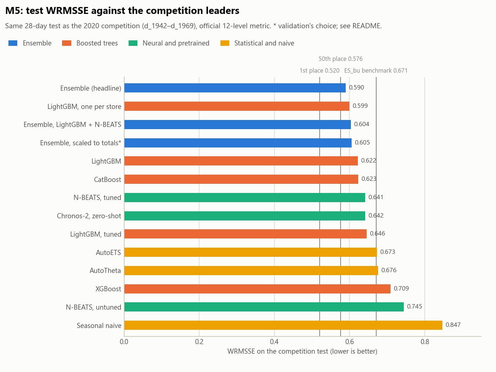
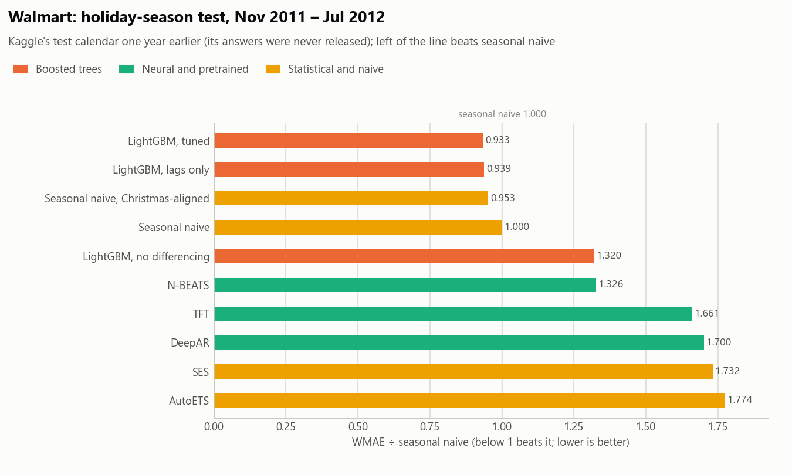
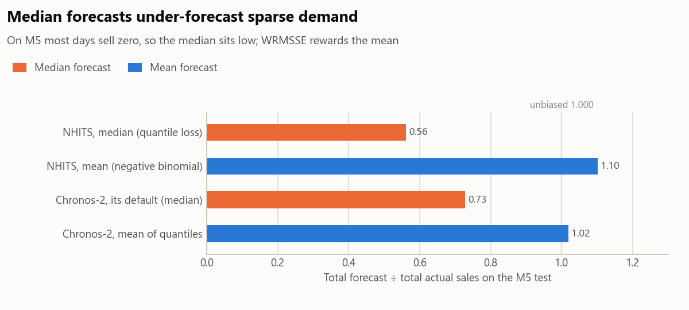
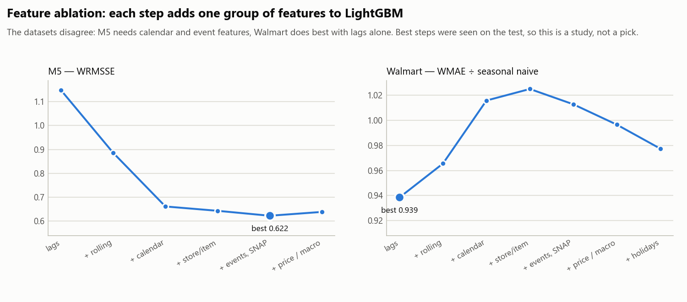
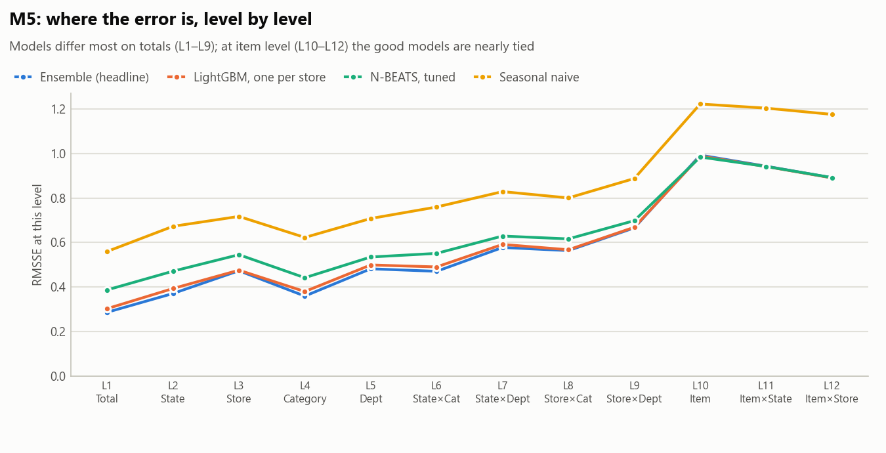
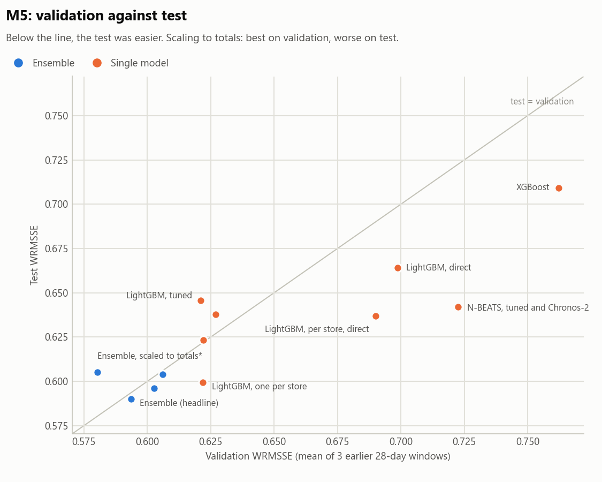

# Retail Demand Forecasting Benchmark

About 40 forecasting methods, from seasonal naive to gradient-boosted trees, deep
learning and a pretrained foundation model, compared under one protocol on two Walmart
datasets from Kaggle: **M5** (30,490 daily item × store series) and **Walmart Store
Sales** (3,331 weekly department × store series). The M5 results are scored on the
competition's own test period with its official metric, so they sit directly beside the
published leaderboard.

| | Our best | Compared with |
|---|---|---|
| **M5**, WRMSSE (lower is better) | **0.590** | the M5 leaderboard: winner 0.520 · 50th place 0.576 · official ES_bu benchmark 0.671 |
| **Walmart**, WMAE ÷ seasonal naive | **0.933** | baselines only: Kaggle never released its test answers, so there is no leaderboard to compare with |

On M5, 0.590 would have ranked roughly 50th–106th of 5,507 teams. That is an estimate,
not a placing: we did not compete, and we saw the test more often than a competitor
could. The headline also needs a caveat: the score validation actually chose is
**0.605** (see [How far to trust these numbers](#how-far-to-trust-these-numbers)).



## Contents

- [Results](#results): M5, the leaderboard, Walmart
- [What the experiments showed](#what-the-experiments-showed)
- [How far to trust these numbers](#how-far-to-trust-these-numbers)
- [Method](#method): data, evaluation, models
- [Repository layout](#repository-layout), [checking the headline](#checking-the-headline-without-retraining) and [reproducing the results](#reproducing-the-results)

Three notebooks tell the full story with their outputs saved:
[01 · the data](notebooks/01_eda.ipynb),
[02 · demand patterns](notebooks/02_intermittency.ipynb),
[03 · results](notebooks/03_results.ipynb).

## Results

### M5: the competition test

The same 28 days the 2020 competition was scored on (2016-05-23 to 2016-06-19). WRMSSE
measures error at 12 levels of aggregation, from total sales (L1) down to each item in
each store (L12), weighted by dollar sales. Our scorer reproduces the official benchmark
scores (Naive 1.752, seasonal naive 0.847).

| Model | WRMSSE | ÷ seasonal naive | L1 total | L9 store × dept | L12 item × store |
|---|---|---|---|---|---|
| **Ensemble (headline)** | **0.590** | 0.696 | 0.287 | 0.666 | 0.892 |
| Ensemble of four (with XGBoost, CatBoost) | 0.596 | 0.704 | 0.296 | 0.675 | 0.891 |
| LightGBM, one model per store (best single model) | 0.599 | 0.708 | 0.303 | 0.669 | 0.891 |
| Ensemble, LightGBM + N-BEATS | 0.604 | 0.713 | 0.322 | 0.675 | 0.891 |
| Ensemble, scaled to store × dept totals (validation's choice) | 0.605 | 0.715 | 0.347 | 0.661 | 0.893 |
| LightGBM (calendar + event features) | 0.622 | 0.734 | 0.325 | 0.708 | 0.895 |
| CatBoost | 0.623 | 0.736 | 0.298 | 0.724 | 0.897 |
| N-BEATS, tuned | 0.641 | 0.757 | 0.387 | 0.699 | 0.892 |
| Chronos-2, zero-shot (no training on M5) | 0.642 | 0.758 | 0.378 | 0.704 | 0.893 |
| AutoETS (best statistical model) | 0.673 | 0.794 | 0.431 | 0.728 | 0.914 |
| XGBoost | 0.709 | 0.837 | 0.496 | 0.777 | 0.893 |
| Seasonal naive | 0.847 | 1.000 | 0.560 | 0.888 | 1.176 |
| TFT · DeepAR · NHITS · BiTCN (untuned) | 0.965 · 1.029 · 1.234 · 1.481 | | | | |

The headline ensemble is 0.65 tuned LightGBM + 0.30 per-store direct LightGBM + 0.05
tuned N-BEATS, with weights chosen on three validation months. All 42 rows are in
[results/tables/wrmsse_m5_competition.csv](results/tables/wrmsse_m5_competition.csv).

### Against the leaderboard

Official results from Makridakis, Spiliotis and Assimakopoulos, *The M5 accuracy
competition: Results, findings, and conclusions* (International Journal of Forecasting,
2022).

| Entry | WRMSSE | Better than ES_bu |
|---|---|---|
| 1st place (YJ_STU) | 0.520 | 22.5% |
| 10th | 0.547 | 18.5% |
| 50th | 0.576 | 14.2% |
| **Ours: headline ensemble** | **0.590** | **12.1%** |
| Ours: best single model | 0.599 | 10.7% |
| Ours: validation's choice | 0.605 | 9.8% |
| ES_bu, the best official benchmark | 0.671 | 0% |

The paper reports 106 teams more than 10% better than ES_bu and 42 more than 15% better.
We are 13% behind the winner.

### Walmart: the holiday season

Kaggle never released the test answers, so the test here is Kaggle's test calendar one
year earlier: train to 2011-10-28, forecast the 39 weeks from 2011-11-04 to 2012-07-27,
covering Thanksgiving and Christmas. Scored with Kaggle's metric, WMAE (holiday weeks
count 5×), relative to seasonal naive.

| Model | WMAE ($) | ÷ seasonal naive |
|---|---|---|
| **LightGBM, tuned** (lags only, seasonally differenced) | **1,809** | **0.933** |
| Seasonal naive, Christmas-aligned | 1,846 | 0.953 |
| Seasonal naive | 1,938 | 1.000 |
| LightGBM without seasonal differencing | 2,558 | 1.320 |
| N-BEATS (best neural model) | 2,569 | 1.326 |
| SES (best statistical model) | 3,357 | 1.732 |

There is no leaderboard comparison for Walmart: the test year differs from Kaggle's and
its answers were never released. Against the baselines, tuned LightGBM is 6.7% better
than seasonal naive and 2% better than the Christmas-aligned version in WMAE. Per series
the second gap is not significant: the two are tied on mean rank
([notebook 03](notebooks/03_results.ipynb)).



## What the experiments showed

**1. Pick the metric before the model.** About 60% of M5's item-days sell nothing. On
MASE, a forecast of all zeros (0.857) beats LightGBM (0.954) and every statistical model,
because MASE rewards forecasting too little. So M5 is ranked by RMSSE and WRMSSE here,
with the ratio of total forecast to total actual sales as a bias check.

**2. Forecast the mean, not the median.** On sparse demand the median sits far below the
mean. NHITS trained with quantile loss forecast 56% of actual sales and scored 2.57;
trained on a negative binomial likelihood and forecasting its mean, it scored 1.23 (still
weak untuned, and now 10% high rather than 44% low). Chronos-2's
built-in point forecast is also its median (1.707); the mean computed from its quantiles
scores 0.642.



**3. Features matter more than the model.** In a study adding one feature group at a time
to LightGBM on M5, calendar features cut the error from 0.885 to 0.661, a bigger gain than
any change of model; events and SNAP days took it to 0.622, and prices made it slightly
worse. Walmart is the opposite: lags alone did best.



**4. The models differ on totals, not items.** Per item, the strong models are nearly
tied: LightGBM, CatBoost, tuned N-BEATS and Chronos-2 are within about 0.01 of each other
in every demand class. What separates them is aggregate accuracy, levels L1 to L9, which
is also where the ensemble gains.



**5. One validation month is not enough.** Tuning LightGBM on a single 28-day window
improved validation from 0.614 to 0.519, but the test got worse (0.638 to 0.683): the
tuned model over-forecast total sales by 6%, which one month could not detect. Every later
choice was made on the mean of three validation months.

**6. Validation can still mislead.** Scaling the ensemble's forecasts toward separately
forecast store × department totals improved validation (0.594 to 0.580) but made the test
worse (0.590 to 0.605). The error on total sales rose from 0.287 to 0.347. The cause has
not been diagnosed.



**7. Ideas from the M5 winners carry over.** One LightGBM per store (0.599) beat one model
across all stores (0.622). A "direct" model, using only data at least 28 days old, is weak
alone (0.637) but takes 30% of the best blend because its errors differ.

**8. Walmart needs the holidays handled explicitly.** Plain LightGBM under-forecast the
holiday spikes and carried Christmas into January (1.32 × seasonal naive). Predicting the
change from the same week last year fixed most of it (0.977), and tuning took it to 0.933.
The dataset's own holiday flag marks the
week *after* Christmas, not the peak week.

## How far to trust these numbers

The rule throughout was that validation windows decide and the test only reports. It was
not kept perfectly, and these are the exceptions:

- **The headline is partly test-informed.** Validation preferred the scaled ensemble
  (0.605); 0.590 is reported because the scaling step was dropped after it failed on the
  test.
- **The M5 test was scored many times** as candidates were added, which a competitor
  could not do.
- **Two choices followed test results.** The M5 feature set (calendar and events) was
  picked from the feature study, which was scored on the test, and the three-month
  validation protocol was adopted after the one-month tuning failed on the test.
- **The M5 test month was easier than validation** for most models.
- **Tuning effort was unequal.** XGBoost uses settings translated from LightGBM; CatBoost
  ran on the GPU, which disables per-tree column sampling; most neural models are untuned,
  and NHITS tuning crashed.
- **The Walmart test is a year earlier than Kaggle's** (whose answers were never
  released), so Walmart is compared with baselines only, not with the leaderboard.
- **Point forecasts only**: no prediction intervals were scored.

## Method

### Data

| | M5 Forecasting – Accuracy | Walmart Store Sales Forecasting |
|---|---|---|
| Series | 30,490 item × store (3,049 products, 10 stores, 3 states) | 3,331 department × store (45 stores) |
| Frequency, history | daily, 2011-01-29 to 2016-06-19 | weekly, 2010-02-05 to 2012-10-26 |
| Horizon | 28 days | 39 weeks |
| Extra data | prices, events, SNAP (food-stamp) days | holidays, promotions (MarkDowns), CPI, fuel, unemployment |
| Character | sparse: 60% of days sell zero after an item's first sale | dominated by Thanksgiving and Christmas |

Setup and download: [data/README.md](data/README.md).

### Evaluation

- **Same windows for every model.** The runner refuses to report if two models were
  scored on different series or windows.
- **Official metrics.** M5 uses the competition's 12-level WRMSSE
  ([evaluation/m5.py](src/forecasting/evaluation/m5.py)), Walmart its WMAE
  ([evaluation/walmart.py](src/forecasting/evaluation/walmart.py)).
- **Validation before test.** Tuning and ensemble weights use three earlier 28-day M5
  windows (forecast origins d_1913, d_1885, d_1857), and the test is scored once per
  choice.
- **Per-series measures** (RMSSE, MASE, WAPE), demand classes (smooth, erratic,
  intermittent, lumpy) and significance tests (Nemenyi ranks, bootstrap and Wilcoxon with
  Holm correction) support the headline metrics.

### Models

| Family | Models |
|---|---|
| Naive | Zero, Naive, Seasonal naive, Historic average, Christmas-aligned seasonal naive |
| Statistical | AutoETS, AutoTheta, SES (statsforecast) |
| Sparse demand | Croston, Croston SBA, TSB, ADIDA, IMAPA |
| Boosted trees | LightGBM (global, per store, direct, Tweedie, seasonally differenced, tuned), XGBoost, CatBoost |
| Neural | N-BEATS, N-BEATSx, NHITS, TFT, DeepAR, BiTCN (neuralforecast) |
| Pretrained | Chronos-2, zero-shot |
| Ensembles | Weighted blends, weights searched on validation windows |

Amazon's MQCNN is not included: it exists only in `gluonts.mx`, and MXNet was retired in
2023 and does not work with NumPy 2. TFT and BiTCN cover the same design space.

## Repository layout

```
configs/            one YAML per experiment: models and settings, no numbers hidden in code
src/forecasting/
  data/             loaders for M5 and Walmart, features, holiday calendar
  models/           one fit/predict interface; baselines, trees, neural models, Chronos
  evaluation/       metrics, official M5 and Walmart scorers, backtesting, significance tests
  viz/              the plotting helpers behind every figure
experiments/        run_benchmark.py, tune.py, ensemble.py, reconcile.py, run_significance.py
scripts/            download_data.py, score_m5_forecast.py, make_figures.py, rebuild_summaries.py
notebooks/          01 data, 02 demand patterns, 03 results
results/            summary tables, tuning trials and figures (per-series files: see below)
tests/              unit and integration tests, run on every push
```

## Checking the headline without retraining

The [releases page](../../releases) has two downloads:

- **`test_forecasts.zip`**: every model's saved test forecast (M5 and Walmart), 269 MB;
- **`per_series_results.zip`**: each model's error on every series, 166 MB, needed to
  rerun the significance tests (`experiments/run_significance.py`).

Unzip either at the repository root. To rescore the M5 headline with the official metric:

```bash
pip install -e .
python scripts/download_data.py --dataset m5          # Kaggle setup in data/README.md
python scripts/download_data.py --dataset m5-labels
python scripts/score_m5_forecast.py results/forecasts/m5_competition/Ensemble-3w-winner.parquet
# Ensemble-3w-winner    WRMSSE 0.5899   L1 0.287  L9 0.666  L12 0.892   zero-filled 0
```

## Reproducing the results

Install a CUDA build of PyTorch first if you will run the neural models
([pytorch.org](https://pytorch.org)); they are about 17× slower on CPU. Developed on
Python 3.10 with a 6 GB RTX 3050 and 16 GB of RAM; the full M5 runs take hours.

```bash
pip install -e ".[neural,trees,data,viz]"
python scripts/download_data.py --dataset all     # Kaggle setup in data/README.md

# Every model on the M5 competition test and the Walmart holiday window
python experiments/run_benchmark.py --config configs/m5_competition.yaml
python experiments/run_benchmark.py --config configs/walmart_season.yaml

# Tuning on validation windows only
python experiments/tune.py --dataset m5 --trials 30 --windows 3
python experiments/tune.py --dataset m5 --model nbeats --trials 30 --windows 3
python experiments/tune.py --dataset walmart --trials 60

# The headline ensemble, then the totals-scaling step
python experiments/ensemble.py --name Ensemble-3w-winner --members \
    LightGBM-tuned-3w,N-BEATS-tuned-3w,XGBoost-l2,CatBoost-l2,LightGBM-store,LightGBM-direct,LightGBM-store-direct
python experiments/reconcile.py

# Significance tests and figures, from the saved tables (no retraining)
python experiments/run_significance.py --dataset m5 --mode competition
python scripts/make_figures.py
```

Useful flags: `--dry-run` lists windows and models without training, `--only gbm,baselines`
runs a subset, `--skip-existing` resumes an interrupted run, and
`--config configs/smoke.yaml` checks the whole pipeline in about a minute.

## License

MIT, see [LICENSE](LICENSE).
